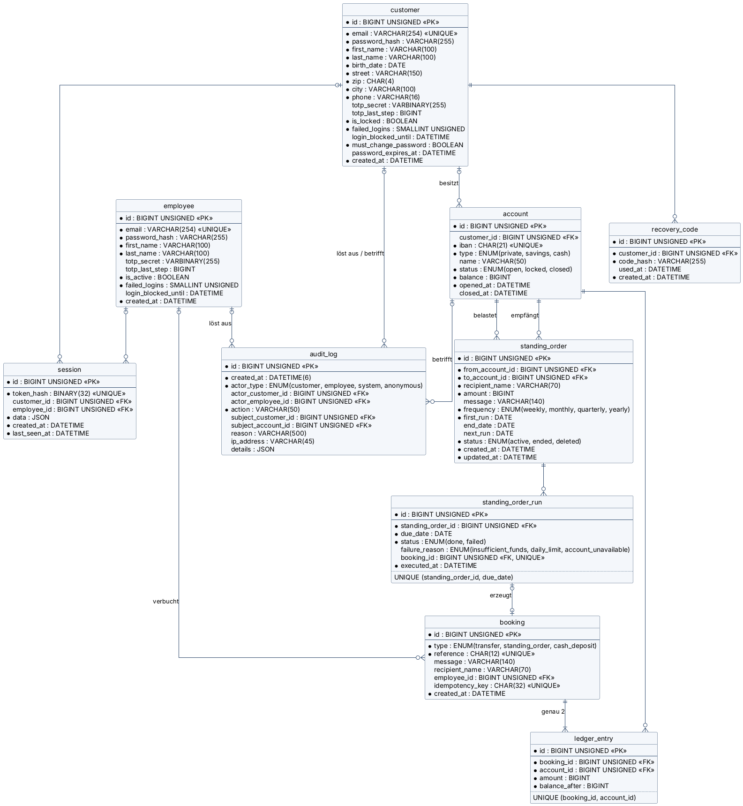

# I let claude redo the whole document, as I wasn't that clear in some things in the previous commits, also it made the ERM diagram, just like in UC, this entire document and the diagram are just placeholders, so I roughly know what we want / what we have to do and how to set everything up, the versions that we end up giving to the teacher will be made by us.
# Datenmodell AckSec

Arbeitsversion für die ERM-Abgabe am 30.11. Zuerst kommt das ERM als Bild, danach die Entitäten und Beziehungen, wie wir sie aus den Use Cases abgeleitet haben, und zum Schluss die Tabellen im Detail mit Datentypen und Constraints.

Die Tabellennamen sind englisch, weil sie so auch im Code heissen werden. Beschrieben wird alles auf Deutsch.

## ERM

Das ERM ist in Krähenfuss-Notation gezeichnet. Zwei Striche am Ende einer Linie heissen «genau eins». Ein Kreis mit Strich heisst «keins oder eins», ein Kreis mit Krähenfuss «keins oder viele» und ein Strich mit Krähenfuss «eins oder viele». Ein Punkt vor einer Spalte bedeutet NOT NULL. Die CHECK-Constraints sind im Bild weggelassen, damit es lesbar bleibt, sie stehen unten bei den einzelnen Tabellen.

Zwei Dinge kann die Notation nicht ganz genau ausdrücken. Bei booking zu ledger_entry steht im Bild «eins oder viele», gemeint ist aber genau zwei. Das prüft die Anwendung (siehe «Regeln über mehrere Zeilen»). Zwischen customer und audit_log gibt es eigentlich zwei Fremdschlüssel, einen für die Person, die etwas getan hat, und einen für die betroffene Person. Im Bild ist das eine Linie mit der Beschriftung «löst aus / betrifft», damit nicht noch mehr Linien das Diagramm kreuzen.

Das Bild wird aus `diagramme/erm.puml` mit PlantUML erzeugt.

## Entitäten

### customer (Kund*in)
Eine Person mit Zugang zum E-Banking. Gespeichert werden die Personalien aus der Registrierung (Vorname, Nachname, Geburtsdatum, Adresse, Telefonnummer), die E-Mail-Adresse als Benutzername, der Passwort-Hash und das 2FA-Secret. Dazu kommen Felder für den Zustand des Zugangs: ob er gesperrt ist (UC7), wie viele Fehlversuche es hintereinander gab und bis wann der Login deshalb gesperrt ist (UC2), ob beim nächsten Login das Passwort geändert werden muss und bis wann ein Einmalpasswort gültig ist (UC9). Für den Schutz gegen wiederverwendete 2FA-Codes merken wir uns, welcher Code zuletzt benutzt wurde (UC2, Ablauf D).

Gebraucht in UC1, UC2, UC7, UC8, UC9, UC10.

### employee (Mitarbeiter*in)
Angestellte der Bank. Gespeichert werden Name, E-Mail-Adresse, Passwort-Hash, 2FA-Secret und dieselben Felder für Fehlversuche wie beim Kunden. Mitarbeitende werden per Kommandozeile angelegt und haben alle dieselben Rechte, darum gibt es keine Rollen-Tabelle.

Gebraucht in UC7, UC9.

### recovery_code (Recovery-Code)
Die zehn Einmal-Codes, mit denen Kund*innen die 2FA selber neu einrichten können. Jeder Code ist eine eigene Zeile mit Hash und dem Zeitpunkt, an dem er benutzt wurde. Eine eigene Tabelle statt einer Spalte beim Kunden, weil jeder Code einzeln entwertet wird.

Gebraucht in UC1, UC9.

### account (Konto)
Ein Bankkonto mit IBAN, Kontotyp (Privatkonto, Sparkonto), Bezeichnung, Status (offen, gesperrt, geschlossen) und aktuellem Saldo in Rappen. Das Kassenkonto der Bank, gegen das Bareinzahlungen gebucht werden, ist ebenfalls ein Konto, aber mit eigenem Typ und ohne Kunde.

Gebraucht in UC1, UC3, UC4, UC5, UC6, UC7.

### booking (Buchung)
Ein Geschäftsvorfall, also eine Überweisung, die Ausführung eines Dauerauftrags oder eine Bareinzahlung. Gespeichert werden Art, Referenznummer, Zeitpunkt, Mitteilung und der vom Absender eingegebene Empfängername. Bei einer Bareinzahlung wird die Mitarbeiterin bzw. der Mitarbeiter festgehalten, bei einer Überweisung ein Schlüssel gegen doppeltes Absenden (UC4, Ablauf J).

Gebraucht in UC4, UC5, UC6, UC7.

### ledger_entry (Buchungszeile)
Die eigentliche Bewegung auf einem Konto. Jede Buchung hat genau zwei Buchungszeilen: eine Belastung (negativer Betrag) auf dem einen Konto und eine Gutschrift (positiver Betrag) auf dem anderen. Jede Zeile speichert auch den Saldo des Kontos nach der Buchung, weil die Transaktionshistorie ihn anzeigt (UC5) und er sonst bei jeder Anzeige aus allen früheren Buchungen berechnet werden müsste.

Gebraucht in UC4, UC5, UC6, UC7.

### standing_order (Dauerauftrag)
Ein Dauerauftrag mit Belastungskonto, Empfängerkonto, Empfängername, Betrag, Mitteilung, Intervall, Datum der ersten Ausführung, optionalem Enddatum, Datum der nächsten Ausführung und Status (aktiv, beendet, gelöscht).

Gebraucht in UC3 (Konto schliessen nur ohne aktive Daueraufträge), UC6.

### standing_order_run (Ausführung eines Dauerauftrags)
Ein Eintrag pro Dauerauftrag und Fälligkeitstag, mit Ergebnis (ausgeführt oder fehlgeschlagen) und bei einem Fehlschlag dem Grund. Bei Erfolg zeigt der Eintrag auf die erzeugte Buchung. Diese Tabelle braucht es aus zwei Gründen: Kund*innen sehen so, wann eine Ausführung fehlgeschlagen ist (UC6, Ablauf E), und weil es pro Dauerauftrag und Datum nur einen Eintrag geben darf, kann ein Fälligkeitstag nach einem Ausfall nie doppelt ausgeführt werden (UC6, Ablauf F).

Gebraucht in UC6.

### audit_log (Audit-Log)
Ein Eintrag pro sicherheitsrelevanter Aktion: Zeitpunkt, wer es war (Kund*in, Mitarbeiter*in oder System), welche Aktion, welche Person bzw. welches Konto betroffen ist, die Begründung bei Aktionen von Mitarbeitenden, die IP-Adresse und bei Bedarf Details wie alter und neuer Wert (UC7, Ablauf H). Einträge werden nur hinzugefügt, nie geändert oder gelöscht.

Gebraucht in allen Use Cases.

### session (Session)
Eine angemeldete Session mit Zeitpunkt der Anmeldung und der letzten Aktivität, damit die Timeouts aus UC2 geprüft werden können. Eine Session gehört entweder zu einem Kunden oder zu einer Mitarbeiterin bzw. einem Mitarbeiter. In der Datenbank wird nur ein Hash der Session-ID gespeichert, damit ein Datenbank-Leak keine gültigen Sessions verrät. Über die Tabelle lassen sich alle Sessions einer Person auf einmal beenden (UC7, Ablauf G, UC8, UC9).

Gebraucht in UC2, UC7, UC8, UC9.

## Beziehungen

| Beziehung | Kardinalität | Begründung |
|-----------|--------------|------------|
| customer besitzt account | 1 : 0..n (Kassenkonto ohne Kunde) | Kund*innen haben bis zu fünf offene Konten, dazu geschlossene (UC3) |
| customer hat recovery_code | 1 : 0..n | Zehn Codes pro Einrichtung, bei einer neuen Einrichtung werden die alten gelöscht (UC9) |
| customer hat session | 1 : 0..n | Mehrere Geräte gleichzeitig möglich (UC8, Schritt 5) |
| employee hat session | 1 : 0..n | wie oben |
| booking besteht aus ledger_entry | 1 : 2 | Doppelte Buchführung, genau eine Belastung und eine Gutschrift (UC4) |
| account hat ledger_entry | 1 : 0..n | Alle Bewegungen eines Kontos ergeben die Historie (UC5) |
| account ist Belastungskonto von standing_order | 1 : 0..n | UC6 |
| account ist Empfängerkonto von standing_order | 1 : 0..n | UC6, Empfänger ist immer ein AckSec-Konto |
| standing_order hat standing_order_run | 1 : 0..n | Ein Eintrag pro Fälligkeitstag (UC6) |
| standing_order_run erzeugt booking | 0..1 : 0..1 | Nur erfolgreiche Ausführungen haben eine Buchung |
| employee verbucht booking | 1 : 0..n | Nur bei Bareinzahlungen (UC7, Ablauf E) |
| customer bzw. employee löst audit_log-Eintrag aus | 1 : 0..n | Beim System als Auslöser sind beide leer |
| audit_log betrifft customer bzw. account | 0..1 : 0..n | z.B. welches Konto gesperrt wurde (UC7) |

Damit kommen wir auf zehn Tabellen und deutlich mehr als vier Beziehungen. Die Mindestanforderung ist also klar erfüllt, ohne dass wir Tabellen nur für die Anzahl erfinden mussten.

## Tabellen im Detail

Für alle Tabellen gilt: MySQL 8 mit InnoDB, Zeichensatz `utf8mb4`. Jede Tabelle hat einen künstlichen Primärschlüssel `id` vom Typ `BIGINT UNSIGNED AUTO_INCREMENT`. Alle Zeitpunkte werden als `DATETIME` in UTC gespeichert und erst bei der Anzeige in Schweizer Zeit umgerechnet. Alle Fremdschlüssel haben `ON DELETE RESTRICT`, eine Zeile, auf die noch etwas zeigt, kann also nicht gelöscht werden. Das ist bei einer Bank gewollt, weil Kund*innen, Konten und Buchungen nie wirklich gelöscht werden, sondern nur einen anderen Status bekommen.

Für feste Auswahlwerte wie Kontotyp oder Status verwenden wir `ENUM`. Die Datenbank lehnt dann jeden anderen Wert ab, und wir brauchen keine zusätzlichen Nachschlagetabellen für Listen, die sich nie ändern.

### customer

| Spalte | Typ | Constraints | Bemerkung |
|--------|-----|-------------|-----------|
| id | BIGINT UNSIGNED | PK | |
| email | VARCHAR(254) | NOT NULL, UNIQUE | 254 ist die maximale Länge einer E-Mail-Adresse. Die Sortierung `utf8mb4_0900_ai_ci` ignoriert Gross-/Kleinschreibung, darum ist auch `Max@x.ch` und `max@x.ch` doppelt. |
| password_hash | VARCHAR(255) | NOT NULL | Argon2id-Hash inkl. Salt und Parametern |
| first_name | VARCHAR(100) | NOT NULL | |
| last_name | VARCHAR(100) | NOT NULL | |
| birth_date | DATE | NOT NULL, CHECK ≥ 1900-01-01 | Das Mindestalter von 18 prüft die Anwendung, siehe unten |
| street | VARCHAR(150) | NOT NULL | |
| zip | CHAR(4) | NOT NULL, CHECK vier Ziffern, erste nicht 0 | Nur Schweizer Postleitzahlen |
| city | VARCHAR(100) | NOT NULL | |
| phone | VARCHAR(16) | NOT NULL, CHECK Format `+41...` (E.164) | Einheitlich gespeichert, egal wie es eingegeben wurde |
| totp_secret | VARBINARY(255) | NULL | Verschlüsselt. NULL heisst: 2FA noch nicht eingerichtet (UC1, Ablauf F) |
| totp_last_step | BIGINT | NULL | Zeitschritt des zuletzt benutzten Codes, gegen Wiederverwendung (UC2, Ablauf D) |
| is_locked | BOOLEAN | NOT NULL, DEFAULT FALSE | Zugang durch Mitarbeitende gesperrt (UC7, Ablauf G) |
| failed_logins | SMALLINT UNSIGNED | NOT NULL, DEFAULT 0 | Fehlversuche hintereinander (UC2, Ablauf C) |
| login_blocked_until | DATETIME | NULL | |
| must_change_password | BOOLEAN | NOT NULL, DEFAULT FALSE | Nach einem Einmalpasswort (UC9, Ablauf C) |
| password_expires_at | DATETIME | NULL, CHECK nur gesetzt, wenn must_change_password | Ablauf des Einmalpassworts |
| created_at | DATETIME | NOT NULL, DEFAULT CURRENT_TIMESTAMP | |

Das 2FA-Secret wird verschlüsselt und nicht gehasht gespeichert, weil die Anwendung es bei jedem Login braucht, um den erwarteten Code auszurechnen. Der Schlüssel dafür liegt nicht in der Datenbank, sondern in der Konfiguration der Anwendung. Ein Dump der Datenbank allein reicht also nicht, um Codes zu erzeugen.

### employee

| Spalte | Typ | Constraints | Bemerkung |
|--------|-----|-------------|-----------|
| id | BIGINT UNSIGNED | PK | |
| email | VARCHAR(254) | NOT NULL, UNIQUE | |
| password_hash | VARCHAR(255) | NOT NULL | |
| first_name | VARCHAR(100) | NOT NULL | |
| last_name | VARCHAR(100) | NOT NULL | |
| totp_secret | VARBINARY(255) | NULL | Wird beim ersten Login eingerichtet, vorher geht nichts |
| totp_last_step | BIGINT | NULL | |
| is_active | BOOLEAN | NOT NULL, DEFAULT TRUE | Ausgetretene Mitarbeitende werden deaktiviert statt gelöscht, weil das Audit-Log auf sie zeigt |
| failed_logins | SMALLINT UNSIGNED | NOT NULL, DEFAULT 0 | |
| login_blocked_until | DATETIME | NULL | |
| created_at | DATETIME | NOT NULL, DEFAULT CURRENT_TIMESTAMP | |

### recovery_code

| Spalte | Typ | Constraints | Bemerkung |
|--------|-----|-------------|-----------|
| id | BIGINT UNSIGNED | PK | |
| customer_id | BIGINT UNSIGNED | NOT NULL, FK → customer | |
| code_hash | VARCHAR(255) | NOT NULL | Argon2id, gleich wie Passwörter |
| used_at | DATETIME | NULL | NULL heisst: noch nicht benutzt |
| created_at | DATETIME | NOT NULL, DEFAULT CURRENT_TIMESTAMP | |

### session

| Spalte | Typ | Constraints | Bemerkung |
|--------|-----|-------------|-----------|
| id | BIGINT UNSIGNED | PK | |
| token_hash | BINARY(32) | NOT NULL, UNIQUE | SHA-256 der Session-ID aus dem Cookie |
| customer_id | BIGINT UNSIGNED | NULL, FK → customer | |
| employee_id | BIGINT UNSIGNED | NULL, FK → employee | |
| data | JSON | NOT NULL | Zwischenstände, z.B. Passwort geprüft, aber 2FA noch offen, oder eine Überweisung, die auf den Code wartet |
| created_at | DATETIME | NOT NULL | |
| last_seen_at | DATETIME | NOT NULL | Für den Timeout nach 10 Minuten Inaktivität (UC2, Ablauf I) |

CHECK: `customer_id` und `employee_id` sind nie beide gesetzt. Beide leer ist erlaubt, weil es schon vor dem Login eine Session braucht, zum Beispiel für das CSRF-Token im Login-Formular.

Für die Session-ID im Cookie reicht SHA-256 statt Argon2id, weil sie zufällig und lang genug ist, dass man sie nicht durchprobieren kann. Ein langsamer Hash würde nur jede Anfrage bremsen.

### account

| Spalte | Typ | Constraints | Bemerkung |
|--------|-----|-------------|-----------|
| id | BIGINT UNSIGNED | PK | |
| customer_id | BIGINT UNSIGNED | NULL, FK → customer | NULL nur beim Kassenkonto |
| iban | CHAR(21) | NOT NULL, UNIQUE, CHECK Format `CH` + 19 Zeichen | Schweizer IBANs sind immer 21 Zeichen lang. Die Prüfziffer kontrolliert die Anwendung. |
| type | ENUM('private', 'savings', 'cash') | NOT NULL | Privatkonto, Sparkonto, Kassenkonto der Bank |
| name | VARCHAR(50) | NULL | Frei wählbare Bezeichnung, z.B. «Ferien» |
| status | ENUM('open', 'locked', 'closed') | NOT NULL, DEFAULT 'open' | |
| balance | BIGINT | NOT NULL, DEFAULT 0 | Saldo in Rappen |
| opened_at | DATETIME | NOT NULL, DEFAULT CURRENT_TIMESTAMP | |
| closed_at | DATETIME | NULL | |

Dazu kommen diese CHECK-Constraints:

- `type = 'cash'` genau dann, wenn `customer_id IS NULL`. Ein Kundenkonto hat also immer einen Besitzer und das Kassenkonto nie.
- `balance >= 0`, ausser beim Kassenkonto. Das Kassenkonto wird bei jeder Bareinzahlung belastet und ist darum immer negativ. Sein Betrag entspricht dem Bargeld, das die Bank am Schalter angenommen hat.
- Ein geschlossenes Konto hat Saldo 0 (UC3, Ablauf D).
- `status = 'closed'` genau dann, wenn `closed_at` gesetzt ist.

Geld wird überall als ganze Zahl in Rappen gespeichert. `BIGINT` reicht bis etwa 92 Billiarden Franken, das ist mehr als genug. `DECIMAL(15,2)` wäre auch korrekt gewesen, aber mit ganzen Zahlen muss man beim Rechnen in Python gar nicht erst über Nachkommastellen nachdenken.

### booking

| Spalte | Typ | Constraints | Bemerkung |
|--------|-----|-------------|-----------|
| id | BIGINT UNSIGNED | PK | |
| type | ENUM('transfer', 'standing_order', 'cash_deposit') | NOT NULL | |
| reference | CHAR(12) | NOT NULL, UNIQUE | Zufällige Referenznummer für die Bestätigung (UC4, Schritt 7) |
| message | VARCHAR(140) | NULL | |
| recipient_name | VARCHAR(70) | NULL | Vom Absender eingegeben, nicht geprüft (UC4, Bemerkungen) |
| employee_id | BIGINT UNSIGNED | NULL, FK → employee | Wer die Bareinzahlung verbucht hat |
| idempotency_key | CHAR(32) | NULL, UNIQUE | Gegen doppeltes Absenden (UC4, Ablauf J) |
| created_at | DATETIME | NOT NULL, DEFAULT CURRENT_TIMESTAMP | |

CHECK-Constraints:

- `type = 'cash_deposit'` genau dann, wenn `employee_id` gesetzt ist.
- `type = 'transfer'` genau dann, wenn `idempotency_key` gesetzt ist. Bei Daueraufträgen übernimmt diese Aufgabe der UNIQUE-Constraint in `standing_order_run`.

Bei `idempotency_key` sind mehrere NULL-Werte trotz UNIQUE erlaubt, MySQL zählt NULL nicht als doppelten Wert.

### ledger_entry

| Spalte | Typ | Constraints | Bemerkung |
|--------|-----|-------------|-----------|
| id | BIGINT UNSIGNED | PK | |
| booking_id | BIGINT UNSIGNED | NOT NULL, FK → booking | |
| account_id | BIGINT UNSIGNED | NOT NULL, FK → account | |
| amount | BIGINT | NOT NULL, CHECK `amount <> 0` | Negativ = Belastung, positiv = Gutschrift |
| balance_after | BIGINT | NOT NULL | Saldo des Kontos direkt nach dieser Zeile, für die Historie (UC5) |

UNIQUE auf (`booking_id`, `account_id`): Ein Konto kann in derselben Buchung nicht zweimal vorkommen. Damit verhindert schon die Datenbank eine Überweisung auf das eigene Konto (UC4, Ablauf D).

Index auf (`account_id`, `id`), weil die Historie immer die Zeilen eines Kontos nach Reihenfolge braucht (UC5). Ohne Index müsste MySQL bei jeder Anzeige die ganze Tabelle durchsuchen.

### standing_order

| Spalte | Typ | Constraints | Bemerkung |
|--------|-----|-------------|-----------|
| id | BIGINT UNSIGNED | PK | |
| from_account_id | BIGINT UNSIGNED | NOT NULL, FK → account | Belastungskonto, kann nicht geändert werden (UC6, Ablauf B) |
| to_account_id | BIGINT UNSIGNED | NOT NULL, FK → account | |
| recipient_name | VARCHAR(70) | NOT NULL | |
| amount | BIGINT | NOT NULL, CHECK `amount > 0` | Rappen |
| message | VARCHAR(140) | NULL | |
| frequency | ENUM('weekly', 'monthly', 'quarterly', 'yearly') | NOT NULL | `interval` wäre der naheliegende Name, ist in MySQL aber ein reserviertes Wort |
| first_run | DATE | NOT NULL | Bestimmt auch den Tag im Monat, auf den nach einem kurzen Monat zurückgesprungen wird (UC6, Ablauf G) |
| end_date | DATE | NULL | |
| next_run | DATE | NULL | |
| status | ENUM('active', 'ended', 'deleted') | NOT NULL, DEFAULT 'active' | |
| created_at | DATETIME | NOT NULL, DEFAULT CURRENT_TIMESTAMP | |
| updated_at | DATETIME | NOT NULL, DEFAULT CURRENT_TIMESTAMP ON UPDATE CURRENT_TIMESTAMP | |

CHECK-Constraints:

- `from_account_id <> to_account_id`
- `end_date IS NULL OR end_date >= first_run`
- `status = 'active'` genau dann, wenn `next_run` gesetzt ist. Ein beendeter oder gelöschter Auftrag hat also keine nächste Ausführung mehr.

Index auf (`status`, `next_run`), weil der Scheduler jeden Tag genau danach sucht.

### standing_order_run

| Spalte | Typ | Constraints | Bemerkung |
|--------|-----|-------------|-----------|
| id | BIGINT UNSIGNED | PK | |
| standing_order_id | BIGINT UNSIGNED | NOT NULL, FK → standing_order | |
| due_date | DATE | NOT NULL | Fälligkeitstag, nicht der Tag, an dem der Scheduler lief |
| status | ENUM('done', 'failed') | NOT NULL | |
| failure_reason | ENUM('insufficient_funds', 'daily_limit', 'account_unavailable') | NULL | UC6, Ablauf E |
| booking_id | BIGINT UNSIGNED | NULL, UNIQUE, FK → booking | |
| executed_at | DATETIME | NOT NULL, DEFAULT CURRENT_TIMESTAMP | |

UNIQUE auf (`standing_order_id`, `due_date`): Pro Auftrag und Fälligkeitstag kann es nur einen Eintrag geben. Wenn der Scheduler nach einem Ausfall versehentlich zweimal läuft, schlägt der zweite Versuch an diesem Constraint fehl und die ganze Transaktion inklusive Buchung wird zurückgerollt (UC6, Ablauf F).

CHECK: Entweder `status = 'done'` mit `booking_id` und ohne `failure_reason`, oder `status = 'failed'` ohne `booking_id` und mit `failure_reason`.

### audit_log

| Spalte | Typ | Constraints | Bemerkung |
|--------|-----|-------------|-----------|
| id | BIGINT UNSIGNED | PK | Gibt auch die Reihenfolge an |
| created_at | DATETIME(6) | NOT NULL, DEFAULT CURRENT_TIMESTAMP(6) | Mit Mikrosekunden |
| actor_type | ENUM('customer', 'employee', 'system', 'anonymous') | NOT NULL | `anonymous` z.B. für einen Login-Versuch mit unbekannter E-Mail-Adresse |
| actor_customer_id | BIGINT UNSIGNED | NULL, FK → customer | |
| actor_employee_id | BIGINT UNSIGNED | NULL, FK → employee | |
| action | VARCHAR(50) | NOT NULL | z.B. `login_failed`, `account_locked`, `transfer_done` |
| subject_customer_id | BIGINT UNSIGNED | NULL, FK → customer | Betroffene Person |
| subject_account_id | BIGINT UNSIGNED | NULL, FK → account | Betroffenes Konto |
| reason | VARCHAR(500) | NULL | Begründung der Mitarbeitenden (UC7) |
| ip_address | VARCHAR(45) | NULL | 45 Zeichen reichen auch für IPv6 |
| details | JSON | NULL | z.B. alter und neuer Wert bei geänderten Personalien (UC7, Ablauf H) |

CHECK: Die Actor-Spalten passen zum `actor_type`. Bei `customer` ist nur `actor_customer_id` gesetzt, bei `employee` nur `actor_employee_id`, bei `system` und `anonymous` keine von beiden.

Der Datenbankbenutzer der Anwendung bekommt auf dieser Tabelle nur `INSERT` und `SELECT`, kein `UPDATE` und kein `DELETE`. Selbst wenn jemand eine Lücke in der Anwendung findet, kann er damit seine Spuren im Audit-Log nicht verwischen.

## Regeln über mehrere Zeilen

Einige Regeln aus den Use Cases kann die Datenbank nicht mit einem CHECK-Constraint durchsetzen, weil ein CHECK in MySQL nur die Werte einer einzelnen Zeile sieht oder weil er keine Funktionen wie das aktuelle Datum benutzen darf. Diese Regeln prüft die Anwendung, und zwar innerhalb derselben Transaktion, in der sie die Daten ändert:

- Jede Buchung hat genau zwei Buchungszeilen, deren Beträge zusammen 0 ergeben (UC4).
- Der gespeicherte Saldo jedes Kontos ist gleich der Summe seiner Buchungszeilen (siehe Entscheide).
- Kund*innen haben höchstens fünf offene Konten und immer mindestens ein offenes Privatkonto (UC3).
- Die Tageslimite von 10'000 CHF pro Konto (UC4, Ablauf F).
- Das Mindestalter von 18 Jahren bei der Registrierung (UC1).
- Von einem Sparkonto geht Geld nur auf Konten derselben Person (UC4, Ablauf H).

Für die ersten beiden schreiben wir zusätzlich einen Test, der die ganze Datenbank durchgeht und Alarm schlägt, wenn eine Buchung nicht aufgeht oder ein Saldo nicht stimmt.

## Entscheide

**Kund*innen und Mitarbeitende in getrennten Tabellen.** Wir hätten auch eine gemeinsame Tabelle mit einer Spalte für die Rolle machen können. Das hätte etwas doppelte Arbeit gespart, weil beide ein Passwort und eine 2FA haben. Wir haben uns trotzdem für zwei Tabellen entschieden. Ein Kunden-Login und ein Mitarbeiter-Login sind dadurch technisch zwei verschiedene Dinge, und ein Fehler bei einer Rollenprüfung kann einem Kunden nicht plötzlich die Rechte von Mitarbeitenden geben. Ausserdem braucht jede Tabelle nur die Spalten, die für sie Sinn ergeben. Mitarbeitende haben zum Beispiel keine Adresse und keine Konten.

**Saldo wird im Konto gespeichert.** Man könnte den Saldo auch jedes Mal als Summe aller Buchungszeilen eines Kontos berechnen. Dann könnte er nie falsch sein. Wir speichern ihn trotzdem in `account`, weil wir bei einer Überweisung die Kontozeile mit `SELECT ... FOR UPDATE` sperren, den Saldo prüfen und in derselben Transaktion ändern wollen (UC4, Ablauf K). Ausserdem kann die Datenbank mit einem CHECK-Constraint selber verhindern, dass ein Saldo negativ wird. Bei einem berechneten Saldo ginge beides nicht so einfach. Damit der gespeicherte Saldo nicht unbemerkt von den Buchungen abweicht, schreiben wir einen Test, der für jedes Konto den Saldo mit der Summe seiner Buchungszeilen vergleicht.
