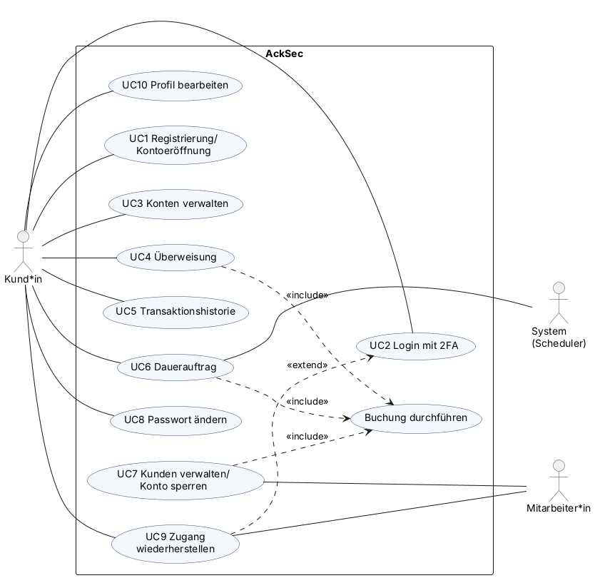

# I decided the use cases, etc... and let claude compile my ideas and rough scenteces into a preview of what the final UC document should be like, then I'll reword this, etc... this is not the real thing, also I let claude code draft a UC diagram, which is also uploaded to the reop, it's not perfect, but it's somethig, helps visualize everything.
# Use Cases AckSec

Arbeitsversion der Use-Case-Dokumentation. Die Felder entsprechen der Schulvorlage (`DBProjekt - UseCase_Vorlage.docx`). Wir schreiben hier, weil man so in Git sieht, wer was geändert hat. Für die Abgabe am 23.11. wird alles in die Word-Vorlage übertragen.

Normalablauf ist immer Ablauf A, die alternativen Abläufe heissen B, C, D usw. und haben jeweils einen kurzen Titel (wann tritt der Fall ein) und danach die Schritte. Wenn ein alternativer Ablauf auf einen Schritt verweist, ist immer ein Schritt aus Ablauf A desselben Use Cases gemeint.

## Akteure

**Kund*in.** Eine Privatperson, die über die Webseite ein Konto bei AckSec eröffnet und danach ihre Konten selber verwaltet: Überweisungen machen, Daueraufträge erfassen, die Historie anschauen und das eigene Profil, Passwort und die 2FA pflegen. Ein Kunde sieht immer nur seine eigenen Daten.

**Mitarbeitende.** Angestellte der Bank, die sich über einen eigenen Login-Bereich anmelden. Für sie ist 2FA Pflicht. Sie können Kunden suchen, Bareinzahlungen am Schalter verbuchen, Konten sperren und wieder entsperren und einem Kunden wieder Zugang geben, wenn er sein Passwort vergessen oder sein Handy samt Recovery-Codes verloren hat. Jede dieser Aktionen braucht eine Begründung und landet im Audit-Log. Eine eigene Administrator-Rolle gibt es bewusst nicht. Alle Mitarbeitenden haben dieselben Rechte, und neue Mitarbeitende werden nicht über die Webseite angelegt, sondern direkt auf dem Server per Kommandozeile. So gibt es keine Weboberfläche, über die jemand sich selbst mehr Rechte geben könnte.

**System (Scheduler).** Kein Mensch, sondern ein Job, der einmal am Tag läuft und die fälligen Daueraufträge ausführt (UC6). Er tritt als eigener Akteur auf, weil er Buchungen auslöst, ohne dass gerade jemand eingeloggt ist.

## Systemgrenze

AckSec ist eine fiktive Bank, es fliesst also kein echtes Geld. Was innerhalb des Systems liegt, ist alles, was über die Webseite oder den Scheduler passiert: Registrierung, Login, Konten, Buchungen zwischen AckSec-Konten, Daueraufträge, Profil und die Funktionen für Mitarbeitende.

Überweisungen und Daueraufträge gehen nur an andere Konten bei AckSec. Eine IBAN einer anderen Bank wird abgelehnt. Dadurch liegen bei jeder Buchung beide Seiten in unserer Datenbank, und die Summe aller Salden lässt sich jederzeit nachprüfen. Geld kommt nur auf einem Weg ins System, nämlich wenn Mitarbeitende eine Bareinzahlung am Schalter verbuchen. Diese Einzahlung wird gegen ein internes Kassenkonto der Bank gebucht, damit auch hier die doppelte Buchführung aufgeht.

Nicht zum System gehören echte Zahlungsnetze wie SIC oder SWIFT, Bargeldbezüge, Karten, Kredite, Wertschriften und Fremdwährungen. Alle Beträge sind in CHF. AckSec verschickt auch keine E-Mails. Die E-Mail-Adresse dient nur als Benutzername, es gibt also keine Bestätigungsmail bei der Registrierung und keine Benachrichtigung bei einem Passwortwechsel. Wer sein Passwort vergisst, meldet sich bei der Bank und bekommt von Mitarbeitenden ein Einmalpasswort, das beim nächsten Login sofort geändert werden muss (UC9). Ebenfalls ausserhalb liegt die Identitätsprüfung bei der Kontoeröffnung (bei einer echten Bank z.B. per Video-Ident) und bevor Mitarbeitende ein Passwort oder die 2FA zurücksetzen. Wir gehen davon aus, dass diese Prüfung am Telefon oder Schalter stattfindet, im System wird nur festgehalten, dass sie gemacht wurde. Auch das Anlegen von Mitarbeitenden und der Betrieb des Servers (Backups, Updates) sind keine Use Cases, sondern Teil des Betriebs.

## Use-Case-Diagramm

Links steht die Kundschaft, die die meisten Use Cases benutzt, rechts die Mitarbeitenden und der Scheduler. Dass man für fast alles zuerst eingeloggt sein muss (UC2), steht in den Vorbedingungen der einzelnen Use Cases und ist im Diagramm nicht als eigene Beziehung eingezeichnet, sonst würden von jedem Use Case Pfeile zu UC2 gehen.

«Buchung durchführen» ist kein eigener Use Case, den jemand direkt auslöst. Es ist der Teil, den eine Überweisung (UC4), die Ausführung eines Dauerauftrags (UC6) und eine Bareinzahlung (UC7) gemeinsam haben: beide Konten sperren, prüfen, Belastung und Gutschrift buchen, Audit-Eintrag schreiben. Darum ist er mit «include» eingebunden, und im Code wird es dafür auch nur eine einzige Funktion geben.

UC9 erweitert den Login («extend»), weil er nur in bestimmten Fällen dazukommt, nämlich wenn jemand beim Login keinen Zugriff auf die Authenticator-App hat oder ein Einmalpasswort benutzt.

Das Diagramm wird aus `diagramme/use-case-diagramm.puml` mit PlantUML erzeugt.

## UC1 – Registrierung/Kontoeröffnung

**Kurzbeschreibung**
Eine Person, die noch nicht Kund*in bei AckSec ist, eröffnet über die Webseite einen Zugang. Dabei wird automatisch ein Privatkonto mit eigener IBAN eröffnet. Zum Schluss richtet die Person die Zwei-Faktor-Authentifizierung (2FA) mit einer Authenticator-App ein, ohne die man AckSec nicht benutzen kann.

**Akteure**
Kund*in (zu Beginn noch nicht registriert)

**Auslöser**
Eine Person möchte bei AckSec ein Konto eröffnen.

**Vorbedingungen**
Die Person hat noch keinen Zugang mit dieser E-Mail-Adresse. Sie hat ein Smartphone mit einer Authenticator-App (z.B. Google Authenticator, Aegis).

**Normalablauf**

*Ablauf A*
1. Die Person klickt auf der Startseite auf «Konto eröffnen».
2. Sie füllt das Formular aus: Vorname, Nachname, Geburtsdatum, Strasse, PLZ, Ort, Telefonnummer, E-Mail-Adresse und zweimal das gewünschte Passwort.
3. Das System prüft die Angaben: alle Pflichtfelder ausgefüllt, Formate gültig, Person ist mindestens 18 Jahre alt, die beiden Passwörter stimmen überein und das Passwort erfüllt die Passwort-Richtlinie.
4. Das System legt den Zugang an und eröffnet ein Privatkonto mit neuer IBAN und Saldo 0.00 CHF.
5. Das System zeigt einen QR-Code an, den die Person mit ihrer Authenticator-App scannt.
6. Die Person gibt den 6-stelligen Code aus der App ein.
7. Das System prüft den Code, aktiviert die 2FA und zeigt einmalig zehn Recovery-Codes an.
8. Die Person bestätigt, dass sie die Recovery-Codes gespeichert hat, und landet auf der Kontoübersicht (UC3).

**Alternative Abläufe**

*Ablauf B: E-Mail-Adresse ist schon registriert*
1. Bei Schritt 3 stellt das System fest, dass es schon einen Zugang mit dieser E-Mail-Adresse gibt.
2. Das System zeigt eine Meldung an und verweist auf den Login (UC2). Es wird nichts gespeichert.

*Ablauf C: Ungültige Angaben*
1. Bei Schritt 3 ist ein Feld leer, hat ein ungültiges Format oder die Person ist jünger als 18.
2. Das System zeigt beim betroffenen Feld an, was nicht stimmt. Die anderen Angaben bleiben im Formular stehen, die Passwortfelder werden geleert.
3. Weiter bei Schritt 2.

*Ablauf D: Passwort zu schwach oder Wiederholung stimmt nicht*
1. Bei Schritt 3 ist das Passwort kürzer als 12 Zeichen, steht auf der Liste häufiger Passwörter oder die beiden Eingaben sind verschieden.
2. Das System erklärt, was die Richtlinie verlangt. Weiter bei Schritt 2.

*Ablauf E: 2FA-Code falsch*
1. Bei Schritt 7 ist der eingegebene Code falsch oder abgelaufen.
2. Das System zeigt eine Fehlermeldung, der QR-Code bleibt derselbe. Weiter bei Schritt 6.

*Ablauf F: Person bricht nach dem Anlegen ab*
1. Die Person schliesst den Browser nach Schritt 4, bevor die 2FA eingerichtet ist.
2. Der Zugang existiert, ist aber noch nicht benutzbar. Beim nächsten Login muss zuerst die 2FA eingerichtet werden (UC2, Ablauf F).

*Ablauf G: Zu viele Registrierungen*
1. Von derselben IP-Adresse kommen in kurzer Zeit sehr viele Registrierungen.
2. Das System lehnt weitere Versuche für eine Weile ab und zeigt eine entsprechende Meldung.

**Ergebnis**
Die Person ist Kund*in von AckSec, hat einen Zugang mit eingerichteter 2FA und ein Privatkonto mit Saldo 0.00 CHF. Die Registrierung ist im Audit-Log festgehalten.

**Bemerkungen**
Die Identität wird bei der Registrierung nicht geprüft (siehe Systemgrenze). Das ist vertretbar, weil ein neues Konto leer ist und Geld nur über eine Bareinzahlung am Schalter ins System kommt (UC7). Dort sieht die Bank die Person und ihren Ausweis.

Das Passwort wird nie im Klartext gespeichert, sondern mit Argon2id gehasht. Die Recovery-Codes werden ebenfalls nur gehasht gespeichert, darum können sie nur einmal angezeigt werden.

Ablauf B verrät, ob eine E-Mail-Adresse schon bei AckSec registriert ist. Normalerweise vermeidet man das, indem man in jedem Fall «Wir haben Ihnen eine E-Mail geschickt» anzeigt. Weil AckSec keine E-Mails verschickt, geht das hier nicht. Wir begrenzen deshalb die Anzahl Registrierungen pro IP-Adresse (Ablauf G), damit man nicht automatisiert viele Adressen durchprobieren kann.

## UC2 – Login mit 2FA

**Kurzbeschreibung**
Kund*innen melden sich mit E-Mail-Adresse und Passwort an und bestätigen den Login mit einem 6-stelligen Code aus ihrer Authenticator-App. Danach können sie das E-Banking benutzen, bis sie sich abmelden oder die Session abläuft.

**Akteure**
Kund*in

**Auslöser**
Kund*in möchte das E-Banking benutzen.

**Vorbedingungen**
Kund*in hat einen Zugang (UC1). Der Zugang ist nicht gesperrt.

**Normalablauf**

*Ablauf A*
1. Kund*in öffnet die Login-Seite und gibt E-Mail-Adresse und Passwort ein.
2. Das System prüft die Angaben und fragt nach dem 2FA-Code.
3. Kund*in gibt den 6-stelligen Code aus der Authenticator-App ein.
4. Das System prüft den Code. Ein Code, der schon einmal benutzt wurde, wird nicht nochmals akzeptiert.
5. Das System erstellt eine neue Session und zeigt die Kontoübersicht (UC3).

**Alternative Abläufe**

*Ablauf B: E-Mail-Adresse oder Passwort falsch*
1. Bei Schritt 2 gibt es keinen Zugang mit dieser E-Mail-Adresse oder das Passwort ist falsch.
2. Das System zeigt in beiden Fällen dieselbe Meldung «E-Mail-Adresse oder Passwort falsch» und zählt einen Fehlversuch. Weiter bei Schritt 1.

*Ablauf C: Zu viele Fehlversuche*
1. Für einen Zugang gab es fünf Fehlversuche hintereinander, oder von einer IP-Adresse kommen sehr viele Fehlversuche.
2. Das System lehnt für 15 Minuten jeden weiteren Login-Versuch für diesen Zugang bzw. von dieser IP-Adresse ab, auch mit richtigem Passwort.
3. Die Meldung sagt nur, dass es zu viele Versuche gab und man es später nochmals probieren soll.

*Ablauf D: 2FA-Code falsch oder schon benutzt*
1. Bei Schritt 4 ist der Code falsch, abgelaufen oder wurde schon einmal verwendet.
2. Das System zeigt eine Fehlermeldung und zählt einen Fehlversuch (gleicher Zähler wie bei Ablauf C). Weiter bei Schritt 3.

*Ablauf E: Kein Zugriff auf die Authenticator-App*
1. Bei Schritt 3 klickt Kund*in auf «Ich habe keinen Zugriff auf meine App».
2. Weiter mit UC9 (Recovery-Code).

*Ablauf F: 2FA ist noch nicht eingerichtet*
1. Bei Schritt 2 stellt das System fest, dass die 2FA für diesen Zugang noch nicht eingerichtet ist (Abbruch bei der Registrierung oder 2FA wurde von Mitarbeitenden zurückgesetzt).
2. Das System zeigt statt der Code-Abfrage die Einrichtung an, gleich wie in UC1, Schritte 5 bis 8. Erst danach geht es weiter bei Schritt 5.

*Ablauf G: Zugang ist gesperrt*
1. Bei Schritt 2 sind E-Mail-Adresse und Passwort richtig, aber der Zugang wurde von Mitarbeitenden gesperrt (UC7).
2. Das System meldet, dass der Zugang gesperrt ist und man sich bei der Bank melden soll. Es wird keine Session erstellt.

*Ablauf H: Login mit Einmalpasswort*
1. Bei Schritt 1 gibt Kund*in ein Einmalpasswort ein, das Mitarbeitende gesetzt haben.
2. Weiter mit UC9, Ablauf C.

*Ablauf I: Session läuft ab*
1. Kund*in ist angemeldet, macht aber 10 Minuten lang nichts, oder ist seit mehr als 2 Stunden angemeldet.
2. Das System beendet die Session. Bei der nächsten Aktion landet Kund*in auf der Login-Seite und sieht einen Hinweis, dass die Session abgelaufen ist.

*Ablauf J: Abmelden*
1. Kund*in klickt auf «Abmelden».
2. Das System löscht die Session auf dem Server und zeigt die Login-Seite.

**Ergebnis**
Kund*in ist angemeldet und hat eine neue Session. Erfolgreiche und fehlgeschlagene Logins sind im Audit-Log festgehalten.

**Bemerkungen**
Bei Ablauf B dauert die Prüfung gleich lang, egal ob die E-Mail-Adresse existiert oder nicht. Sonst könnte man an der Antwortzeit ablesen, welche Adressen registriert sind.

Nach dem Login bekommt Kund*in immer eine neue Session-ID. Damit funktioniert ein Angriff nicht, bei dem jemand einem Opfer vor dem Login eine bekannte Session-ID unterschiebt (Session Fixation).

Ablauf G wird absichtlich erst angezeigt, wenn das Passwort stimmt. Sonst würde man auch ohne Passwort erfahren, welche Zugänge gesperrt sind.

Der Login für Mitarbeitende funktioniert gleich, aber auf einer eigenen Login-Seite und mit eigener Session. Mit einem Kunden-Login kommt man nicht in den Bereich für Mitarbeitende und umgekehrt.

## UC3 – Konten verwalten

**Kurzbeschreibung**
Kund*innen sehen eine Übersicht über alle ihre Konten mit IBAN und Saldo. Sie können zusätzliche Konten eröffnen (Privatkonto oder Sparkonto) und Konten schliessen, die sie nicht mehr brauchen.

**Akteure**
Kund*in

**Auslöser**
Kund*in möchte sich einen Überblick verschaffen, braucht ein weiteres Konto oder will ein Konto auflösen.

**Vorbedingungen**
Kund*in ist angemeldet (UC2).

**Normalablauf**

*Ablauf A: Kontenübersicht und neues Konto eröffnen*
1. Nach dem Login zeigt das System die Kontenübersicht: alle offenen Konten mit Bezeichnung, Kontotyp, IBAN und Saldo. Gesperrte Konten sind als gesperrt markiert.
2. Kund*in klickt auf «Neues Konto eröffnen».
3. Kund*in wählt den Kontotyp (Privatkonto oder Sparkonto) und gibt optional eine Bezeichnung ein, z.B. «Ferien».
4. Das System prüft, ob Kund*in noch weniger als fünf offene Konten hat.
5. Das System eröffnet das Konto mit neuer IBAN und Saldo 0.00 CHF.
6. Das neue Konto erscheint in der Kontenübersicht.

**Alternative Abläufe**

*Ablauf B: Maximale Anzahl Konten erreicht*
1. Bei Schritt 4 hat Kund*in schon fünf offene Konten.
2. Das System zeigt eine Meldung und eröffnet kein Konto.

*Ablauf C: Konto schliessen*
1. Kund*in wählt in der Übersicht ein Konto und klickt auf «Konto schliessen».
2. Das System prüft, ob der Saldo 0.00 CHF ist, ob keine aktiven Daueraufträge mehr auf dem Konto laufen, ob das Konto nicht gesperrt ist und ob danach noch mindestens ein Privatkonto offen bleibt.
3. Das System fragt nach einer Bestätigung.
4. Kund*in bestätigt.
5. Das System setzt das Konto auf «geschlossen». Es verschwindet aus der Übersicht, die Buchungen bleiben aber erhalten und können weiterhin angeschaut werden (UC5).

*Ablauf D: Saldo ist nicht 0*
1. Bei Ablauf C, Schritt 2, ist noch Geld auf dem Konto.
2. Das System erklärt, dass das Geld zuerst auf ein anderes Konto überwiesen werden muss (UC4). Das Konto bleibt offen.

*Ablauf E: Es gibt noch aktive Daueraufträge*
1. Bei Ablauf C, Schritt 2, läuft noch mindestens ein Dauerauftrag ab diesem Konto.
2. Das System zeigt die betroffenen Daueraufträge an, die zuerst gelöscht werden müssen (UC6). Das Konto bleibt offen.

*Ablauf F: Letztes Privatkonto*
1. Bei Ablauf C, Schritt 2, ist es das letzte offene Privatkonto.
2. Das System erklärt, dass immer mindestens ein Privatkonto offen sein muss. Wer AckSec ganz verlassen will, meldet sich bei der Bank.

*Ablauf G: Konto ist gesperrt*
1. Bei Ablauf C, Schritt 2, ist das Konto gesperrt.
2. Das System erklärt, dass ein gesperrtes Konto nur von der Bank geschlossen werden kann.

*Ablauf H: Kund*in versucht, ein fremdes Konto aufzurufen*
1. Kund*in ändert in der Adresszeile die Konto-ID und versucht so, ein Konto einer anderen Person anzuzeigen oder zu schliessen.
2. Das System antwortet gleich, wie wenn es das Konto gar nicht gäbe («Seite nicht gefunden»), und hält den Versuch im Audit-Log fest.

**Ergebnis**
Kund*in sieht alle eigenen Konten mit aktuellem Saldo. Neu eröffnete Konten sind sofort benutzbar, geschlossene Konten können nicht mehr für Buchungen verwendet werden.

**Bemerkungen**
Ein Sparkonto unterscheidet sich vom Privatkonto dadurch, dass man nur auf eigene Konten überweisen kann (siehe UC4). Zinsen gibt es keine, das liegt ausserhalb des Projekts.

Konten werden nie gelöscht, nur auf «geschlossen» gesetzt. Sonst würden die Buchungen auf das Konto zeigen, das es nicht mehr gibt, und die Historie der Gegenpartei wäre unvollständig. Eine IBAN wird auch nach dem Schliessen nie neu vergeben.

Ablauf H ist der klassische IDOR-Angriff (Insecure Direct Object Reference). Bei jeder Anfrage wird deshalb geprüft, ob das Konto wirklich der angemeldeten Person gehört.

## UC4 – Überweisung

**Kurzbeschreibung**
Kund*innen überweisen Geld von einem ihrer Konten auf ein anderes Konto bei AckSec, entweder ein eigenes oder das einer anderen Person. Die Überweisung wird mit einem 2FA-Code bestätigt und sofort ausgeführt.

**Akteure**
Kund*in

**Auslöser**
Kund*in möchte Geld an jemanden überweisen oder zwischen den eigenen Konten verschieben.

**Vorbedingungen**
Kund*in ist angemeldet (UC2) und hat mindestens ein offenes, nicht gesperrtes Konto mit Guthaben.

**Normalablauf**

*Ablauf A*
1. Kund*in klickt auf «Überweisung».
2. Kund*in wählt das Konto, von dem das Geld abgebucht wird, und gibt die IBAN des Empfängerkontos, den Namen des Empfängers, den Betrag in CHF und optional eine Mitteilung (höchstens 140 Zeichen) ein.
3. Das System prüft die Eingaben: Die IBAN hat ein gültiges Format und eine gültige Prüfziffer, sie gehört zu einem offenen, nicht gesperrten Konto bei AckSec, Empfänger- und Belastungskonto sind nicht dasselbe, und der Betrag ist grösser als 0 und hat höchstens zwei Nachkommastellen.
4. Das System zeigt eine Zusammenfassung der Überweisung und fragt nach dem 2FA-Code.
5. Kund*in prüft die Zusammenfassung und gibt den Code aus der Authenticator-App ein.
6. Das System prüft den Code und führt die Überweisung aus. Dabei prüft es nochmals, ob beide Konten offen und nicht gesperrt sind, ob genug Geld auf dem Belastungskonto ist und ob die Tageslimite eingehalten wird. Dann bucht es den Betrag vom einen Konto ab und schreibt ihn dem anderen gut. Alles passiert in einer einzigen Datenbank-Transaktion.
7. Das System zeigt eine Bestätigung mit Referenznummer und dem neuen Saldo an.

**Alternative Abläufe**

*Ablauf B: IBAN ungültig oder kein aktives AckSec-Konto*
1. Bei Schritt 3 hat die IBAN ein falsches Format, die Prüfziffer stimmt nicht, oder sie gehört zu keinem offenen, nicht gesperrten Konto bei AckSec.
2. Das System zeigt die Meldung «Diese IBAN gehört zu keinem aktiven Konto bei AckSec». Weiter bei Schritt 2.

*Ablauf C: Betrag ungültig*
1. Bei Schritt 3 ist der Betrag 0, negativ, keine Zahl oder hat mehr als zwei Nachkommastellen.
2. Das System zeigt eine Fehlermeldung beim Betrag. Weiter bei Schritt 2.

*Ablauf D: Gleiches Konto*
1. Bei Schritt 3 sind Belastungs- und Empfängerkonto dasselbe.
2. Das System zeigt eine Fehlermeldung. Weiter bei Schritt 2.

*Ablauf E: Ungenügende Deckung*
1. Bei Schritt 6 ist weniger Geld auf dem Belastungskonto als der Betrag. Ein Konto kann nicht überzogen werden.
2. Das System bricht ab, es wird nichts gebucht. Kund*in sieht eine Meldung mit dem verfügbaren Saldo.

*Ablauf F: Tageslimite überschritten*
1. Bei Schritt 6 würde die Summe aller Überweisungen und Daueraufträge von diesem Konto am selben Tag 10'000 CHF übersteigen.
2. Das System bricht ab, es wird nichts gebucht. Die Meldung zeigt, wie viel heute noch möglich ist.

*Ablauf G: 2FA-Code falsch*
1. Bei Schritt 6 ist der Code falsch oder wurde schon benutzt.
2. Das System zeigt eine Fehlermeldung, es wird nichts gebucht. Weiter bei Schritt 5.
3. Nach fünf falschen Codes wird die Überweisung verworfen und Kund*in muss wieder bei Schritt 1 beginnen. Die Fehlversuche zählen auch für die Login-Sperre (UC2, Ablauf C).

*Ablauf H: Sparkonto an fremdes Konto*
1. Bei Schritt 3 ist das Belastungskonto ein Sparkonto und das Empfängerkonto gehört nicht derselben Person.
2. Das System erklärt, dass von einem Sparkonto nur auf eigene Konten überwiesen werden kann. Weiter bei Schritt 2.

*Ablauf I: Belastungskonto ist gesperrt*
1. Bei Schritt 2 oder 6 ist das gewählte Belastungskonto gesperrt.
2. Gesperrte Konten erscheinen gar nicht in der Auswahl. Falls das Konto zwischen Schritt 2 und 6 gesperrt wird, bricht das System bei Schritt 6 ab und es wird nichts gebucht.

*Ablauf J: Überweisung wird doppelt abgeschickt*
1. Bei Schritt 5 klickt Kund*in zweimal auf «Bestätigen» oder lädt die Seite neu.
2. Das System erkennt, dass diese Überweisung schon ausgeführt wurde, und führt sie nicht ein zweites Mal aus. Kund*in sieht die Bestätigung der ersten Ausführung.

*Ablauf K: Zwei Überweisungen gleichzeitig*
1. Zwei Überweisungen vom selben Konto kommen fast gleichzeitig an, z.B. aus zwei Browser-Tabs.
2. Das System verarbeitet sie nacheinander. Die zweite sieht den Saldo nach der ersten und wird abgelehnt, falls das Geld nicht mehr reicht (Ablauf E). Der Saldo kann so nie negativ werden.

*Ablauf L: Technischer Fehler während der Buchung*
1. Bei Schritt 6 tritt ein Fehler auf, z.B. ist die Datenbank kurz nicht erreichbar.
2. Die Transaktion wird vollständig rückgängig gemacht, es gibt also nie eine halbe Buchung, bei der Geld abgebucht, aber nicht gutgeschrieben wurde.
3. Kund*in sieht eine allgemeine Fehlermeldung ohne technische Details und kann es nochmals versuchen.

**Ergebnis**
Der Betrag ist vom Belastungskonto abgebucht und dem Empfängerkonto gutgeschrieben. Die Überweisung erscheint in der Transaktionshistorie beider Konten (UC5) und ist im Audit-Log festgehalten.

**Bemerkungen**
Beträge werden intern als ganze Zahl in Rappen gespeichert (z.B. 12.50 CHF als 1250). Mit Kommazahlen könnten Rundungsfehler entstehen, was bei Geld nicht passieren darf.

Bei jeder Überweisung entstehen zwei Buchungen, eine Belastung und eine Gutschrift (doppelte Buchführung). Auch Bareinzahlungen werden so gebucht, nämlich gegen das Kassenkonto der Bank (UC7). Zählt man das Kassenkonto mit, ist die Summe aller Salden deshalb immer genau 0. Damit lässt sich jederzeit prüfen, ob irgendwo Geld entstanden oder verschwunden ist.

Bei Schritt 6 werden beide Konten in der Datenbank gesperrt, bis die Buchung fertig ist. Das verhindert Ablauf K. Die Konten werden immer in derselben Reihenfolge gesperrt, damit sich zwei Überweisungen in entgegengesetzter Richtung nicht gegenseitig blockieren (Deadlock).

Ablauf B unterscheidet absichtlich nicht, ob ein Konto nicht existiert, geschlossen oder gesperrt ist. Sonst könnte man herausfinden, welche Konten anderer Leute gesperrt sind.

Der Empfängername wird nicht mit dem echten Namen des Kontoinhabers verglichen. Sonst könnte man durch Ausprobieren herausfinden, wem eine IBAN gehört.

Überweisungen werden immer sofort ausgeführt. Für Zahlungen in der Zukunft gibt es die Daueraufträge (UC6).

## UC5 – Transaktionshistorie

**Kurzbeschreibung**
Kund*innen sehen alle Buchungen eines Kontos, also Gutschriften und Belastungen, mit dem Saldo nach jeder Buchung. Sie können die Liste nach Zeitraum und Betrag filtern und als CSV-Datei herunterladen.

**Akteure**
Kund*in

**Auslöser**
Kund*in möchte nachschauen, welche Zahlungen ein- oder ausgegangen sind.

**Vorbedingungen**
Kund*in ist angemeldet (UC2) und hat mindestens ein Konto (offen oder geschlossen).

**Normalablauf**

*Ablauf A*
1. Kund*in klickt in der Kontenübersicht (UC3) auf ein Konto.
2. Das System zeigt die Buchungen dieses Kontos, die neuesten zuerst, 25 pro Seite. Zu jeder Buchung werden Datum und Uhrzeit, Gegenpartei (Name und IBAN bzw. «Bareinzahlung»), Mitteilung, Betrag (Gutschrift positiv, Belastung negativ) und der Saldo nach der Buchung angezeigt.
3. Kund*in blättert bei Bedarf auf ältere Seiten.

**Alternative Abläufe**

*Ablauf B: Filtern*
1. Bei Schritt 2 gibt Kund*in einen Zeitraum (von, bis) und/oder einen Betragsbereich (mindestens, höchstens) ein.
2. Das System prüft die Eingaben und zeigt nur noch die passenden Buchungen an. Der Filter bleibt beim Blättern erhalten.

*Ablauf C: Ungültiger Filter*
1. Bei Ablauf B ist ein Datum ungültig, das Von-Datum liegt nach dem Bis-Datum, oder der Mindestbetrag ist grösser als der Höchstbetrag.
2. Das System zeigt eine Fehlermeldung und lässt die Liste ungefiltert.

*Ablauf D: Keine Buchungen*
1. Bei Schritt 2 hat das Konto noch keine Buchungen, oder der Filter passt auf keine Buchung.
2. Das System zeigt «Keine Buchungen vorhanden» an.

*Ablauf E: CSV-Export*
1. Bei Schritt 2 klickt Kund*in auf «Als CSV herunterladen».
2. Das System erstellt eine CSV-Datei mit allen Buchungen, die zum aktuellen Filter passen (nicht nur der aktuellen Seite), und bietet sie zum Download an.

*Ablauf F: Geschlossenes Konto*
1. Kund*in möchte die Buchungen eines geschlossenen Kontos sehen.
2. Das System zeigt geschlossene Konten in einem eigenen Bereich unter der Kontenübersicht an. Die Historie kann wie bei Schritt 2 angeschaut und exportiert werden.

*Ablauf G: Fremdes Konto*
1. Kund*in ändert in der Adresszeile die Konto-ID, um die Buchungen eines fremden Kontos zu sehen.
2. Das System antwortet mit «Seite nicht gefunden», gleich wie in UC3, Ablauf H.

**Ergebnis**
Kund*in sieht die Buchungen des gewünschten Kontos oder hat sie als CSV-Datei heruntergeladen. An den Daten ändert sich nichts.

**Bemerkungen**
Buchungen können nie geändert oder gelöscht werden, auch nicht von Mitarbeitenden. Bei einer echten Bank würde man einen Fehler mit einer Gegenbuchung korrigieren. Das ist nicht Teil unseres Projekts.

Bei der Gegenpartei wird der Name angezeigt, den der Absender bei der Überweisung eingegeben hat (UC4), nicht der echte Name des Kontoinhabers.

Wenn eine Mitteilung mit «=», «+», «-» oder «@» beginnt, könnte Excel sie beim Öffnen der CSV-Datei als Formel ausführen (CSV-Injection). Da jeder Absender eine Mitteilung frei wählen kann, werden solche Zeichen beim Export entschärft.

## UC6 – Dauerauftrag

**Kurzbeschreibung**
Kund*innen erfassen eine Zahlung, die regelmässig an dasselbe AckSec-Konto geht, z.B. die Miete jeden Monat. Das System führt den Dauerauftrag an jedem Fälligkeitstag automatisch aus, bis er gelöscht wird oder das Enddatum erreicht ist.

**Akteure**
Kund*in, System (Scheduler)

**Auslöser**
Kund*in möchte eine wiederkehrende Zahlung nicht jedes Mal von Hand machen. Für die Ausführung: Ein Dauerauftrag ist fällig.

**Vorbedingungen**
Kund*in ist angemeldet (UC2) und hat mindestens ein offenes, nicht gesperrtes Konto.

**Normalablauf**

*Ablauf A*
1. Kund*in klickt auf «Daueraufträge». Das System zeigt eine Liste aller Daueraufträge mit Empfänger, Betrag, Intervall, nächster Ausführung und Status.
2. Kund*in klickt auf «Neuer Dauerauftrag».
3. Kund*in wählt das Belastungskonto und gibt IBAN und Name des Empfängers, Betrag, optional eine Mitteilung, das Intervall (wöchentlich, monatlich, vierteljährlich oder jährlich), das Datum der ersten Ausführung und optional ein Enddatum ein.
4. Das System prüft die Eingaben gleich wie bei einer Überweisung (UC4, Schritt 3). Zusätzlich muss die erste Ausführung frühestens morgen sein und ein Enddatum muss nach der ersten Ausführung liegen.
5. Das System zeigt eine Zusammenfassung und fragt nach dem 2FA-Code.
6. Kund*in gibt den Code ein. Das System speichert den Dauerauftrag mit dem Status «aktiv».
7. Am Fälligkeitstag führt das System den Dauerauftrag aus. Dabei gelten dieselben Prüfungen wie bei einer Überweisung (UC4, Schritt 6), aber ohne 2FA-Code.
8. Das System berechnet das Datum der nächsten Ausführung. Ist das Enddatum überschritten, setzt es den Dauerauftrag auf «beendet».

**Alternative Abläufe**

*Ablauf B: Dauerauftrag ändern*
1. Bei Schritt 1 wählt Kund*in einen aktiven Dauerauftrag und klickt auf «Ändern».
2. Kund*in kann alle Angaben ausser dem Belastungskonto ändern.
3. Weiter bei Schritt 4. Bei einer Änderung ist ebenfalls ein 2FA-Code nötig.

*Ablauf C: Dauerauftrag löschen*
1. Bei Schritt 1 wählt Kund*in einen Dauerauftrag und klickt auf «Löschen».
2. Das System fragt nach einer Bestätigung.
3. Das System setzt den Dauerauftrag auf «gelöscht». Er wird nicht mehr ausgeführt. Bereits ausgeführte Zahlungen bleiben in der Historie.

*Ablauf D: Ungültige Eingaben*
1. Bei Schritt 4 stimmt etwas nicht, z.B. liegt die erste Ausführung in der Vergangenheit, das Enddatum vor der ersten Ausführung, oder es gilt einer der Fälle aus UC4, Abläufe B, C, D oder H.
2. Das System zeigt eine Fehlermeldung beim betroffenen Feld. Weiter bei Schritt 3.

*Ablauf E: Ausführung nicht möglich*
1. Bei Schritt 7 ist nicht genug Geld auf dem Konto, die Tageslimite wäre überschritten, oder das Belastungs- oder Empfängerkonto ist inzwischen gesperrt oder geschlossen.
2. Das System bucht nichts und vermerkt beim Dauerauftrag, dass die Ausführung an diesem Tag fehlgeschlagen ist und warum. Kund*in sieht den Hinweis in der Liste der Daueraufträge.
3. Der Dauerauftrag wird nicht später nachgeholt. Weiter bei Schritt 8.

*Ablauf F: Server war ausgefallen*
1. Der Scheduler konnte an einem oder mehreren Tagen nicht laufen, z.B. weil der Server neu gestartet wurde.
2. Beim nächsten Lauf führt das System alle Daueraufträge aus, die in der Zwischenzeit fällig gewesen wären. Jeder Fälligkeitstag wird dabei genau einmal ausgeführt, nie doppelt.

*Ablauf G: Fälligkeit am Monatsende*
1. Ein monatlicher Dauerauftrag hat als Datum den 29., 30. oder 31., und der Monat hat weniger Tage.
2. Das System führt den Dauerauftrag am letzten Tag dieses Monats aus. Im nächsten Monat gilt wieder das ursprüngliche Datum.

**Ergebnis**
Der Dauerauftrag ist gespeichert und wird an jedem Fälligkeitstag ausgeführt, solange genug Geld vorhanden ist. Jede Ausführung erscheint als normale Buchung in der Historie (UC5) und ist im Audit-Log festgehalten.

**Bemerkungen**
Bei der Ausführung braucht es keinen 2FA-Code, weil niemand eingeloggt ist. Der Code wird stattdessen beim Erfassen und bei jeder Änderung verlangt. Sonst könnte jemand mit einer gestohlenen Session einfach einen bestehenden Dauerauftrag auf ein eigenes Konto umleiten.

Ablauf F ist bei einem Raspberry Pi nicht unrealistisch, z.B. nach einem Stromausfall. Das System merkt sich deshalb pro Dauerauftrag, für welches Datum er zuletzt ausgeführt wurde, statt nur zu schauen, was heute fällig ist.

Ein Dauerauftrag kann nur zwischen AckSec-Konten laufen, gleich wie eine Überweisung.

## UC7 – Mitarbeitende: Kunden verwalten/Konto sperren

**Kurzbeschreibung**
Mitarbeitende der Bank suchen Kund*innen und sehen deren Personalien und Konten. Sie können Konten und ganze Zugänge sperren und entsperren, Bareinzahlungen am Schalter verbuchen, Personalien korrigieren und das Audit-Log einsehen. Jede Aktion, die etwas verändert, braucht eine Begründung und wird im Audit-Log festgehalten.

**Akteure**
Mitarbeiter*in

**Auslöser**
Eine Kundin oder ein Kunde meldet sich am Schalter oder am Telefon, oder die Bank bemerkt etwas Verdächtiges auf einem Konto.

**Vorbedingungen**
Mitarbeiter*in ist im Bereich für Mitarbeitende angemeldet, mit Passwort und 2FA (siehe UC2, Bemerkungen). Bei Anliegen von Kund*innen wurde deren Identität am Schalter oder Telefon geprüft (siehe Systemgrenze).

**Normalablauf**

*Ablauf A: Kund*in suchen und Konto sperren*
1. Mitarbeiter*in gibt im Suchfeld einen Namen, eine E-Mail-Adresse oder eine IBAN ein.
2. Das System zeigt alle passenden Kund*innen in einer Trefferliste an.
3. Mitarbeiter*in öffnet die Detailansicht einer Person. Das System zeigt Personalien, Status des Zugangs, alle Konten mit Saldo und Status sowie die letzten Logins.
4. Mitarbeiter*in klickt bei einem Konto auf «Sperren» und gibt eine Begründung ein, z.B. «Verdacht auf Betrug, Kunde hat angerufen».
5. Das System sperrt das Konto und hält im Audit-Log fest, wer es wann und warum gesperrt hat.
6. Ab jetzt sind auf diesem Konto keine Belastungen und Gutschriften mehr möglich, auch nicht durch Daueraufträge.

**Alternative Abläufe**

*Ablauf B: Keine Treffer*
1. Bei Schritt 2 passt keine Person zur Suche.
2. Das System zeigt «Keine Kund*innen gefunden». Weiter bei Schritt 1.

*Ablauf C: Begründung fehlt*
1. Bei einer Aktion, die eine Begründung braucht, lässt Mitarbeiter*in das Feld leer.
2. Das System führt die Aktion nicht aus und weist auf das Pflichtfeld hin.

*Ablauf D: Konto entsperren*
1. Bei Schritt 4 klickt Mitarbeiter*in bei einem gesperrten Konto auf «Entsperren» und gibt eine Begründung ein.
2. Das System entsperrt das Konto und hält es im Audit-Log fest.

*Ablauf E: Bareinzahlung verbuchen*
1. Eine Kundin oder ein Kunde bringt am Schalter Bargeld vorbei. Mitarbeiter*in öffnet bei Schritt 3 das gewünschte Konto und klickt auf «Bareinzahlung».
2. Mitarbeiter*in gibt den Betrag ein.
3. Das System prüft, ob das Konto offen und nicht gesperrt ist und ob der Betrag grösser als 0 und höchstens 100'000 CHF ist.
4. Das System zeigt eine Zusammenfassung, Mitarbeiter*in bestätigt.
5. Das System bucht den Betrag vom Kassenkonto der Bank auf das Kundenkonto, in einer Transaktion wie bei UC4, und hält die Einzahlung im Audit-Log fest.
6. Die Einzahlung erscheint in der Historie des Kontos als «Bareinzahlung» (UC5).

*Ablauf F: Bareinzahlung nicht möglich*
1. Bei Ablauf E, Schritt 3, ist der Betrag ungültig oder das Konto ist geschlossen oder gesperrt.
2. Das System zeigt eine Fehlermeldung, es wird nichts gebucht.

*Ablauf G: Zugang sperren oder entsperren*
1. Bei Schritt 3 klickt Mitarbeiter*in auf «Zugang sperren» und gibt eine Begründung ein, z.B. weil jemand anderes das Passwort kennt.
2. Das System sperrt den Zugang und beendet alle laufenden Sessions dieser Person sofort. Ein Login ist nicht mehr möglich (UC2, Ablauf G).
3. Entsperren funktioniert gleich über «Zugang entsperren», ebenfalls mit Begründung.

*Ablauf H: Personalien korrigieren*
1. Bei Schritt 3 klickt Mitarbeiter*in auf «Personalien bearbeiten», z.B. weil eine Kundin nach der Heirat einen neuen Namen hat.
2. Mitarbeiter*in ändert Vorname, Nachname oder Geburtsdatum und gibt eine Begründung ein.
3. Das System prüft die Eingaben gleich wie bei UC1, speichert sie und hält im Audit-Log fest, was vorher und nachher drinstand.

*Ablauf I: Konto durch die Bank schliessen*
1. Bei Schritt 3 klickt Mitarbeiter*in bei einem Konto auf «Konto schliessen» und gibt eine Begründung ein.
2. Das System prüft, ob der Saldo 0.00 CHF ist und keine aktiven Daueraufträge mehr laufen. Anders als in UC3 darf auch ein gesperrtes Konto oder das letzte Privatkonto geschlossen werden.
3. Das System setzt das Konto auf «geschlossen» und hält es im Audit-Log fest.

*Ablauf J: Audit-Log einsehen*
1. Mitarbeiter*in öffnet das Audit-Log.
2. Das System zeigt die Einträge, die neuesten zuerst. Sie können nach Kund*in, Mitarbeiter*in, Art der Aktion und Zeitraum gefiltert werden.

*Ablauf K: Kund*in versucht, den Bereich für Mitarbeitende zu öffnen*
1. Eine angemeldete Kundin oder ein angemeldeter Kunde ruft eine Adresse aus dem Bereich für Mitarbeitende auf.
2. Das System antwortet mit «Seite nicht gefunden» und hält den Versuch im Audit-Log fest.

**Ergebnis**
Die gewünschte Änderung ist gespeichert und im Audit-Log mit Mitarbeiter*in, Zeitpunkt und Begründung festgehalten. Bei einer Bareinzahlung ist das Geld auf dem Kundenkonto.

**Bemerkungen**
Mitarbeitende können absichtlich kein Geld von einem Kundenkonto abbuchen und keine Überweisungen im Namen von Kund*innen machen. Sie können Geld nur hinzufügen (Bareinzahlung). So kann eine Mitarbeiterin oder ein Mitarbeiter mit bösen Absichten kein Geld auf ein eigenes Konto verschieben.

Mitarbeitende sehen weder Passwörter noch 2FA-Secrets, diese sind nur gehasht bzw. verschlüsselt gespeichert. Passwort und 2FA zurücksetzen ist in UC9 beschrieben.

Das Audit-Log kann von niemandem geändert oder gelöscht werden, auch nicht von Mitarbeitenden. Der Datenbankbenutzer der Anwendung hat auf dieser Tabelle nur das Recht, neue Einträge hinzuzufügen und zu lesen.

Wenn ein Kunde AckSec ganz verlassen möchte, überweist er sein Geld zuerst auf ein anderes AckSec-Konto. Danach schliessen Mitarbeitende alle Konten (Ablauf I) und sperren den Zugang (Ablauf G).

## UC8 – Passwort ändern

**Kurzbeschreibung**
Angemeldete Kund*innen ändern ihr Passwort. Dafür braucht es das aktuelle Passwort und einen 2FA-Code. Nach der Änderung werden alle anderen Sessions beendet.

**Akteure**
Kund*in

**Auslöser**
Kund*in möchte das Passwort wechseln, z.B. weil sie befürchtet, dass jemand anderes es kennt.

**Vorbedingungen**
Kund*in ist angemeldet (UC2).

**Normalablauf**

*Ablauf A*
1. Kund*in öffnet die Seite «Sicherheit» und klickt auf «Passwort ändern».
2. Kund*in gibt das aktuelle Passwort, zweimal das neue Passwort und einen 2FA-Code ein.
3. Das System prüft das aktuelle Passwort und den 2FA-Code, ob die beiden neuen Passwörter übereinstimmen, ob das neue Passwort die Passwort-Richtlinie erfüllt (UC1, Ablauf D) und ob es sich vom aktuellen unterscheidet.
4. Das System speichert das neue Passwort.
5. Das System beendet alle anderen Sessions dieser Person, z.B. auf einem anderen Gerät. Die aktuelle Session bekommt eine neue Session-ID.
6. Das System bestätigt die Änderung.

**Alternative Abläufe**

*Ablauf B: Aktuelles Passwort falsch*
1. Bei Schritt 3 stimmt das aktuelle Passwort nicht.
2. Das System zeigt eine Fehlermeldung und zählt einen Fehlversuch (gleicher Zähler wie beim Login, UC2, Ablauf C). Weiter bei Schritt 2.
3. Nach fünf Fehlversuchen wird die Session beendet und der Login für 15 Minuten gesperrt.

*Ablauf C: 2FA-Code falsch*
1. Bei Schritt 3 ist der 2FA-Code falsch oder wurde schon benutzt.
2. Wie Ablauf B.

*Ablauf D: Neues Passwort ungültig*
1. Bei Schritt 3 erfüllt das neue Passwort die Richtlinie nicht, ist gleich wie das aktuelle, oder die beiden Eingaben stimmen nicht überein.
2. Das System zeigt, was nicht stimmt. Es zählt nicht als Fehlversuch. Weiter bei Schritt 2.

**Ergebnis**
Das neue Passwort ist gespeichert. Nur die aktuelle Session ist noch gültig. Die Änderung ist im Audit-Log festgehalten.

**Bemerkungen**
Das aktuelle Passwort und der 2FA-Code werden verlangt, obwohl Kund*in schon angemeldet ist. Wenn jemand an einem fremden Computer eine offene Session findet, kann er so das Passwort nicht ändern und den eigentlichen Besitzer aussperren.

Schritt 5 ist wichtig, wenn jemand das Passwort gerade wegen eines Verdachts ändert. Ein Angreifer, der noch eingeloggt ist, fliegt dadurch sofort raus.

Weil AckSec keine E-Mails verschickt, wird Kund*in nicht zusätzlich per E-Mail über die Änderung informiert.

## UC9 – Zugang wiederherstellen (Passwort/2FA)

**Kurzbeschreibung**
Kund*innen, die keinen Zugriff mehr auf ihre Authenticator-App haben, richten die 2FA mit einem Recovery-Code selber neu ein. Wer das Passwort vergessen oder Handy und Recovery-Codes verloren hat, meldet sich bei der Bank. Mitarbeitende setzen dann nach einer Identitätsprüfung ein Einmalpasswort und bei Bedarf auch die 2FA zurück.

**Akteure**
Kund*in, Mitarbeiter*in

**Auslöser**
Kund*in hat das Handy verloren, die Authenticator-App gelöscht oder das Passwort vergessen.

**Vorbedingungen**
Kund*in hat einen Zugang mit eingerichteter 2FA (UC1). Für Ablauf A kennt Kund*in das Passwort und hat noch mindestens einen unbenutzten Recovery-Code.

**Normalablauf**

*Ablauf A: 2FA mit Recovery-Code neu einrichten*
1. Kund*in gibt beim Login E-Mail-Adresse und Passwort ein und klickt bei der Abfrage des 2FA-Codes auf «Ich habe keinen Zugriff auf meine App» (UC2, Ablauf E).
2. Kund*in gibt einen der Recovery-Codes ein.
3. Das System prüft den Code und markiert ihn als benutzt.
4. Das System zeigt einen neuen QR-Code an. Kund*in scannt ihn mit der App auf dem neuen Handy und gibt zur Bestätigung den ersten Code ein. Das alte 2FA-Secret ist ab jetzt ungültig.
5. Das System zeigt zehn neue Recovery-Codes an. Alle alten Recovery-Codes sind ab jetzt ungültig.
6. Kund*in bestätigt, dass die neuen Codes gespeichert sind, und landet auf der Kontoübersicht (UC3).

**Alternative Abläufe**

*Ablauf B: Recovery-Code falsch*
1. Bei Ablauf A, Schritt 3, ist der Code falsch oder wurde schon benutzt.
2. Das System zeigt eine Fehlermeldung und zählt einen Fehlversuch (gleicher Zähler wie beim Login, UC2, Ablauf C). Weiter bei Schritt 2.

*Ablauf C: Passwort vergessen, Einmalpasswort durch Mitarbeitende*
1. Kund*in meldet sich am Schalter oder am Telefon. Mitarbeiter*in prüft die Identität.
2. Mitarbeiter*in öffnet die Detailansicht der Person (UC7, Schritt 3), klickt auf «Einmalpasswort setzen» und gibt eine Begründung ein.
3. Das System erzeugt ein zufälliges Einmalpasswort und zeigt es Mitarbeiter*in genau einmal an. Das bisherige Passwort ist ab jetzt ungültig und alle laufenden Sessions der Person werden beendet. Das Einmalpasswort ist 24 Stunden gültig.
4. Mitarbeiter*in gibt das Einmalpasswort an Kund*in weiter (am Schalter auf Papier, am Telefon mündlich).
5. Kund*in meldet sich mit E-Mail-Adresse, Einmalpasswort und 2FA-Code an (UC2, Schritte 1 bis 4).
6. Das System verlangt sofort ein neues Passwort, zweimal eingegeben. Es muss die Passwort-Richtlinie erfüllen (UC1, Ablauf D).
7. Das System speichert das neue Passwort, das Einmalpasswort ist ab jetzt ungültig. Kund*in landet auf der Kontoübersicht.

*Ablauf D: Handy und Recovery-Codes verloren*
1. Bei Ablauf C, Schritt 2, wählt Mitarbeiter*in zusätzlich «2FA zurücksetzen».
2. Das System löscht zusätzlich das 2FA-Secret und alle Recovery-Codes.
3. Bei Ablauf C, Schritt 5, braucht Kund*in deshalb keinen 2FA-Code. Nach dem neuen Passwort (Schritt 6) richtet Kund*in die 2FA gleich wie in UC1, Schritte 5 bis 8, neu ein.

*Ablauf E: Einmalpasswort abgelaufen*
1. Kund*in versucht sich erst nach mehr als 24 Stunden mit dem Einmalpasswort anzumelden.
2. Das System behandelt es wie ein falsches Passwort (UC2, Ablauf B). Kund*in muss sich nochmals bei der Bank melden.

*Ablauf F: Abbruch vor dem neuen Passwort*
1. Kund*in schliesst bei Ablauf C, Schritt 6, den Browser, ohne ein neues Passwort zu setzen.
2. Mit dieser Session kann Kund*in nichts anderes machen als das Passwort setzen. Das Einmalpasswort bleibt gültig, bis es abläuft, und beim nächsten Login kommt wieder Schritt 6.

**Ergebnis**
Kund*in hat wieder Zugang mit einem selbst gewählten Passwort und funktionierender 2FA. Alle Aktionen, also Recovery-Code benutzt, Einmalpasswort gesetzt und 2FA zurückgesetzt, sind im Audit-Log festgehalten.

**Bemerkungen**
Mitarbeitende können die 2FA nur zusammen mit einem Einmalpasswort zurücksetzen, nie allein. Sonst könnte jemand, der das Passwort gestohlen hat, bei der Bank anrufen, die 2FA zurücksetzen lassen und danach mit dem gestohlenen Passwort die 2FA auf seinem eigenen Handy einrichten. So wird das alte Passwort beim Zurücksetzen ungültig, und das neue bekommt nur die Person, deren Identität geprüft wurde.

Das Einmalpasswort wird wie ein normales Passwort nur gehasht gespeichert. Weil Kund*in es sofort ändern muss, kennen Mitarbeitende das endgültige Passwort nie.

Ablauf A verlangt das Passwort und einen Recovery-Code. Wer nur einen von beiden hat, kommt nicht rein, die Zwei-Faktor-Sicherheit bleibt also auch hier bestehen.

## UC10 – Profil bearbeiten

**Kurzbeschreibung**
Kund*innen sehen ihre Personalien und können Adresse, Telefonnummer und E-Mail-Adresse selber ändern. Name und Geburtsdatum können nur Mitarbeitende ändern.

**Akteure**
Kund*in

**Auslöser**
Kund*in ist umgezogen, hat eine neue Telefonnummer oder eine neue E-Mail-Adresse.

**Vorbedingungen**
Kund*in ist angemeldet (UC2).

**Normalablauf**

*Ablauf A: Adresse oder Telefonnummer ändern*
1. Kund*in öffnet die Seite «Profil». Das System zeigt Vorname, Nachname, Geburtsdatum, Adresse, Telefonnummer und E-Mail-Adresse an.
2. Kund*in klickt auf «Bearbeiten» und ändert Strasse, PLZ, Ort oder Telefonnummer.
3. Das System prüft die Eingaben gleich wie bei der Registrierung (UC1, Schritt 3).
4. Das System speichert die Änderungen und zeigt eine Bestätigung an.

**Alternative Abläufe**

*Ablauf B: Ungültige Eingaben*
1. Bei Schritt 3 ist ein Feld leer oder hat ein ungültiges Format.
2. Das System zeigt beim betroffenen Feld, was nicht stimmt, und speichert nichts. Weiter bei Schritt 2.

*Ablauf C: E-Mail-Adresse ändern*
1. Bei Schritt 1 klickt Kund*in auf «E-Mail-Adresse ändern».
2. Kund*in gibt die neue E-Mail-Adresse und das aktuelle Passwort ein.
3. Das System prüft das Passwort und ob die neue Adresse gültig und noch nicht von einem anderen Zugang verwendet wird.
4. Das System speichert die neue Adresse. Ab jetzt meldet sich Kund*in damit an.

*Ablauf D: Passwort falsch*
1. Bei Ablauf C, Schritt 3, stimmt das Passwort nicht.
2. Das System zeigt eine Fehlermeldung und zählt einen Fehlversuch (gleicher Zähler wie beim Login, UC2, Ablauf C). Die E-Mail-Adresse wird nicht geändert.

*Ablauf E: E-Mail-Adresse schon vergeben*
1. Bei Ablauf C, Schritt 3, gibt es schon einen Zugang mit der neuen Adresse.
2. Das System zeigt eine Meldung und ändert nichts.

*Ablauf F: Name oder Geburtsdatum ändern*
1. Kund*in möchte den Namen oder das Geburtsdatum ändern.
2. Diese Felder sind auf der Profilseite nicht bearbeitbar. Ein Hinweis erklärt, dass man sich dafür bei der Bank melden muss (UC7, Ablauf H).

**Ergebnis**
Die geänderten Personalien sind gespeichert. Bei einer Änderung der E-Mail-Adresse sind alte und neue Adresse im Audit-Log festgehalten.

**Bemerkungen**
Die E-Mail-Adresse ist gleichzeitig der Benutzername. Darum braucht eine Änderung das aktuelle Passwort, sonst könnte jemand mit einer fremden offenen Session die Adresse ändern, und die eigentliche Person wüsste danach nicht mehr, mit welchem Benutzernamen sie sich anmelden kann.

Name und Geburtsdatum sind bei einer Bank an den Ausweis gebunden. Deshalb können sie nur Mitarbeitende ändern, nachdem sie die Identität geprüft haben.
